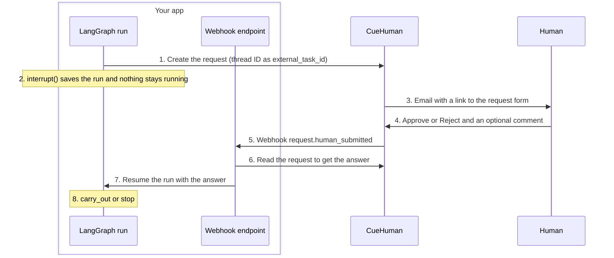

# Pause a LangGraph run for a human, and resume it by webhook

An approval step for a LangGraph workflow. The graph asks a person to approve an action, pauses, and carries on when the person answers. The wait can last days, and nothing stays running while the graph is paused.

This page first shows the code you add to your own graph, then how to run the complete example in this folder.

## How it works

Your app has two parts here: the LangGraph run, and one web endpoint that receives CueHuman's webhooks. CueHuman reaches the human and collects the answer.



A request that expires or is canceled resumes the run the same way, with no choice, and the run stops without acting.

## Add it to your graph

There are three pieces: a node that creates the request, a node that pauses, and a webhook endpoint that resumes the run.

### 1. Create the request in its own node

From `graph.py`:

```python
def ask_human(state: State, config: RunnableConfig) -> State:
    """Creates the CueHuman request. Its own node, so it is not repeated when the run resumes."""
    request = cuehuman.create_request(
        external_task_id=config["configurable"]["thread_id"],  # How the webhook finds this run.
        email=state["approver_email"],
        prompt=f"An AI agent wants to: {state['action']}. Do you approve?",
        options=[APPROVE, REJECT],
    )
    return {"request_id": request["request_id"]}
```

`create_request` is one call to `POST /v1/requests`. From `cuehuman.py`, this is what it sends:

```python
    body = {
        "external_task_id": external_task_id,
        "human": {"email": email},
        "type": "decision",
        "prompt": prompt,
        "schema": {"options": options},
        "allow_comment": True,
        "webhook_name": os.environ["CUEHUMAN_WEBHOOK_NAME"],  # The profile that points at your endpoint.
    }
```

- **Keep this in its own node.** When a run resumes, LangGraph runs the paused node again from its first line. A create call in the same node as `interrupt()` would run a second time.
- **Send the thread ID as `external_task_id`.** The webhook carries it back, so your endpoint knows which run to resume. A repeated create with the same value returns the same request, and the human is not asked twice. That is why `cuehuman.py` can safely send a call again after a dropped connection. To ask more than one question in a run, add a suffix to it.

### 2. Pause in the next node

From `graph.py`:

```python
def wait_for_human(state: State) -> State:
    """Pauses the run until the webhook endpoint resumes it with the human's answer."""
    answer = interrupt({"request_id": state["request_id"]})
    return {"answer": answer}
```

`interrupt()` saves the run through the graph's checkpointer and stops. The value your endpoint resumes with is what `interrupt()` returns, so the next node can read `state["answer"]`.

### 3. Resume the run from your webhook endpoint

From `webhook_server.py`:

```python
@app.post("/webhooks/cuehuman")
async def cuehuman_webhook(request: Request, background: BackgroundTasks) -> dict:
    raw_body = await request.body()  # The signature covers these exact bytes.
    if not cuehuman.verify_webhook(raw_body, request.headers.get("X-CueHuman-Signature", "")):
        raise HTTPException(status_code=401, detail="Invalid signature")
    event = json.loads(raw_body)
    if event["event"] in RESUMING_EVENTS:
        background.add_task(resume_run, event)  # Answer first: CueHuman waits 8 seconds for the reply.
    return {"received": True}


def resume_run(event: dict) -> None:
    thread_id = event["external_task_id"]
    config = {"configurable": {"thread_id": thread_id}}

    # Resume only a run that is paused on this request. A repeated or late event finds none.
    paused_on = [paused.value.get("request_id") for paused in graph.get_state(config).interrupts]
    if event["request_id"] not in paused_on:
        log.info("Ignored %s for %s: no run is paused on it", event["event"], event["request_id"])
        return

    # The event says what happened, not what the human answered. Read the request for that.
    request = cuehuman.get_request(event["request_id"])
    answer = {
        "status": request["status"],
        "choice": (request["result"] or {}).get("choice"),
        "comment": request["comment"],
    }
    result = graph.invoke(Command(resume=answer), config)
    log.info("Resumed %s after %s -> %s", thread_id, event["event"], result.get("outcome"))
```

- **Check the signature first.** `verify_webhook` in `cuehuman.py` checks the `X-CueHuman-Signature` header against the raw body, so a forged call cannot resume a run.
- **Read the request for the answer.** The event says what happened to which request. It does not carry the human's choice.
- **Resume only a run that is paused on that request.** CueHuman can deliver an event more than once. The second time, no run is paused on it, and nothing happens.
- **Handle three events:** `request.human_submitted`, `request.expired` and `request.canceled`. Otherwise a run whose request expires would wait forever.

This endpoint is part of your own app. In the example it runs as a separate process from the script that starts the run, to show that nothing has to stay running while the run waits. In your app it would be one route in the service that runs your graph.

## Run the complete example

| File | What it does |
|---|---|
| `graph.py` | The graph: `ask_human`, `wait_for_human`, then `carry_out` or `stop` |
| `webhook_server.py` | The webhook endpoint that resumes the waiting run |
| `cuehuman.py` | The CueHuman calls: create a request, read it, check a webhook's signature |
| `start_run.py` | Starts a run and exits while it waits |
| `show_run.py` | Shows where a run is |

### Set up

```bash
python -m venv .venv && source .venv/bin/activate
pip install -r requirements.txt
cp .env.example .env
```

In the CueHuman Developer Portal:

1. Create an agent and copy its test key into `CUEHUMAN_API_KEY`.
2. Create a webhook profile that points at `https://<your-host>/webhooks/cuehuman`, with signing on. Subscribe it to `request.human_submitted`, `request.expired` and `request.canceled`.
3. Put the profile's name in `CUEHUMAN_WEBHOOK_NAME` and its signing secret in `CUEHUMAN_WEBHOOK_SECRET`.

CueHuman must be able to reach the endpoint over HTTPS. On your own machine, use a tunnel such as `cloudflared` or `ngrok` and give the profile the tunnel's address.

### Run it

Start the webhook endpoint:

```bash
uvicorn webhook_server:app --port 8000
```

In a second terminal, start a run. With a test key, the address must belong to a member of your organization.

```bash
python start_run.py "Refund order 1042 for \$1,250.00" you@example.com
```

```
Thread:  approval-1b9d6bcd-bbfd-4b2d-9b5d-ab8dfbbd4bed
Request: req_8fK9xL2pQ1mZb4vNt7wYs
Paused, waiting for the human.
```

Open the email and answer. The endpoint logs the resume:

```
Resumed approval-1b9d6bcd-bbfd-4b2d-9b5d-ab8dfbbd4bed after request.human_submitted -> Approved. Carried out: Refund order 1042 for $1,250.00
```

Check a run at any time:

```bash
python show_run.py approval-1b9d6bcd-bbfd-4b2d-9b5d-ab8dfbbd4bed
```

## Before production

- Use a Postgres checkpointer in place of SQLite.
- Replace `carry_out` with the real action.
- Switch to a `cue_live_` key to reach people outside your organization.

## Tracing with LangSmith

Set `LANGSMITH_TRACING=true`, `LANGSMITH_API_KEY` and `LANGSMITH_PROJECT` in `.env`. Each run then appears in LangSmith as two traces on the same thread: one that ends at the pause, and one for the resume.
