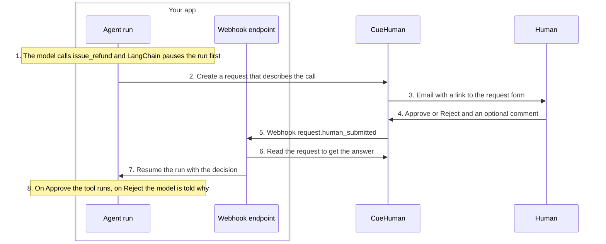

# An approval gate: a tool that cannot run until a person approves the call

An agent with a refund tool. LangChain stops the agent every time the model tries to call that tool, CueHuman asks a person to approve that exact call, and the tool runs only on Approve.

The model does not decide whether to ask. You name the tools that need approval, and LangChain's human-in-the-loop middleware enforces it. For a tool the model calls by choice, see the [ask-and-wait tool](../ask-and-wait-tool/).

This page first shows the code you add to your own agent, then how to run the complete example in this folder.

## How it works

Your app has two parts here: the agent run, and one web endpoint that receives CueHuman's webhooks. CueHuman reaches the human and collects the answer.



A request that expires or is canceled resumes the run as a rejection, so the tool does not run.

## Add it to your agent

There are three pieces: the middleware that names the tools, a function that asks a person about each paused call, and a webhook endpoint that resumes the run.

### 1. Name the tools that need approval

From `agent.py`:

```python
agent = create_agent(
    model=os.environ["MODEL"],
    tools=[issue_refund],
    system_prompt="You handle billing problems. Refund an order when the customer is owed the money.",
    middleware=[
        HumanInTheLoopMiddleware(
            interrupt_on={"issue_refund": {"allowed_decisions": ["approve", "reject"], "description": describe_refund}},
            interrupt_mode="per_call",  # One pause, and one question, for each call.
        )
    ],
    # A SQLite checkpointer, so a paused run survives a restart. Use Postgres in production.
    checkpointer=SqliteSaver(sqlite3.connect("checkpoints.sqlite", check_same_thread=False)),
)
```

- **`interrupt_on` lists the gated tools.** Every other tool runs as usual.
- **`per_call` pauses once for each call.** If the model asks for two refunds in one turn, each gets its own request and its own answer.
- **The agent needs a checkpointer,** because the pause saves the run.

The `description` is what the person reads. From `agent.py`:

```python
def describe_refund(tool_call, state, runtime) -> str:
    """What the approver reads: the exact call the agent wants to make."""
    args = tool_call["args"]
    return f"An AI agent wants to refund ${args['amount_usd']:,.2f} on order {args['order_id']}. Do you approve?"
```

Write it from the call's arguments, so the person approves exactly what will run.

### 2. Ask a person about each paused call

From `agent.py`:

```python
def advance(agent_input, thread_id: str):
    """Runs the agent until it finishes or pauses, then asks a person about each paused call."""
    result = agent.invoke(agent_input, {"configurable": {"thread_id": thread_id}}, version="v2")
    ask_about_paused_calls(thread_id)
    return result


def ask_about_paused_calls(thread_id: str) -> None:
    """Creates one CueHuman request for each tool call the run is paused on. Safe to call again."""
    for paused in agent.get_state({"configurable": {"thread_id": thread_id}}).interrupts:
        cuehuman.create_request(
            external_task_id=f"{thread_id}:{paused.id}",  # How the webhook finds the run and the call.
            email=os.environ["APPROVER_EMAIL"],
            prompt=paused.value["description"],
            options=[APPROVE, REJECT],
        )
```

- **Call `advance` wherever you would call `agent.invoke`:** when you start a run, and when you resume one. A resumed run can pause again on a later call, and `advance` asks about that one too.
- **The `external_task_id` holds the thread ID and the pause's ID.** The webhook carries it back, so your endpoint knows which run to resume and which call the answer is for. A repeated create with the same value returns the same request, and the person is not asked twice.

### 3. Resume the run from your webhook endpoint

From `webhook_server.py`:

```python
def resume_run(event: dict) -> None:
    thread_id, paused_id = event["external_task_id"].split(":", 1)

    # Resume only a run that is paused on this call. A repeated or late event finds none.
    paused_calls = agent.get_state({"configurable": {"thread_id": thread_id}}).interrupts
    if paused_id not in [paused.id for paused in paused_calls]:
        log.info("Ignored %s for %s: no run is paused on it", event["event"], event["request_id"])
        return

    # The event says what happened, not what the human answered. Read the request for that.
    request = cuehuman.get_request(event["request_id"])
    if (request["result"] or {}).get("choice") == APPROVE:
        decision = {"type": "approve"}
    elif request["status"] == "completed":
        decision = {"type": "reject", "message": request["comment"] or "The approver rejected this call."}
    else:
        message = f"Nobody approved this call (the request {request['status']}), so it did not run. Do not try again."
        decision = {"type": "reject", "message": message}

    result = advance(Command(resume={paused_id: decision}), thread_id)
    if result.interrupts:
        log.info("Resumed %s with %s; it is now waiting on another call", thread_id, decision["type"])
    else:
        log.info("Resumed %s with %s -> %s", thread_id, decision["type"], result.value["messages"][-1].text)
```

- **The answer becomes a decision.** Approve lets the tool run. Reject stops it, and the person's comment goes to the model as the reason. An expiry or a cancel is a rejection too.
- **Read the request for the answer.** The event says what happened to which request. It does not carry the person's choice.
- **Resume only a run that is paused on that call.** CueHuman can deliver an event more than once. The second time, no run is paused on it, and nothing happens.

The route that receives the webhook checks the `X-CueHuman-Signature` header before anything else, as in [pause and resume](../pause-and-resume/). This endpoint is part of your own app: in the example it runs as a separate process from the script that starts the run, and in your app it would be one route in the service that runs your agent.

## Run the complete example

| File | What it does |
|---|---|
| `agent.py` | The agent, the middleware, and `advance` |
| `webhook_server.py` | The webhook endpoint that resumes the waiting run |
| `cuehuman.py` | The CueHuman calls: create a request, read it, check a webhook's signature |
| `start_run.py` | Starts a run and exits while it waits |
| `show_run.py` | Shows where a run is |

### Set up

```bash
python -m venv .venv && source .venv/bin/activate
pip install -r requirements.txt
cp .env.example .env
```

In the CueHuman Developer Portal:

1. Create an agent and copy its test key into `CUEHUMAN_API_KEY`.
2. Create a webhook profile that points at `https://<your-host>/webhooks/cuehuman`, with signing on. Subscribe it to `request.human_submitted`, `request.expired` and `request.canceled`.
3. Put the profile's name in `CUEHUMAN_WEBHOOK_NAME` and its signing secret in `CUEHUMAN_WEBHOOK_SECRET`.

Then fill in the rest of `.env`: the approver's address, and a model with its provider's key. To use another provider, install its LangChain package and change `MODEL`.

CueHuman must be able to reach the endpoint over HTTPS. On your own machine, use a tunnel such as `cloudflared` or `ngrok` and give the profile the tunnel's address.

### Run it

Start the webhook endpoint:

```bash
uvicorn webhook_server:app --port 8000
```

In a second terminal, start a run:

```bash
python start_run.py "Customer 8841 was double charged \$1,250.00 on order 1042. Please fix it."
```

```
Thread: refund-1b9d6bcd-bbfd-4b2d-9b5d-ab8dfbbd4bed
Paused, waiting for a person: An AI agent wants to refund $1,250.00 on order 1042. Do you approve?
```

Open the email and answer. The endpoint logs the resume:

```
Resumed refund-1b9d6bcd-bbfd-4b2d-9b5d-ab8dfbbd4bed with approve -> I refunded $1,250.00 on order 1042 for customer 8841, which covers the duplicate charge.
```

Check a run at any time:

```bash
python show_run.py refund-1b9d6bcd-bbfd-4b2d-9b5d-ab8dfbbd4bed
```

## Before production

- Use a Postgres checkpointer in place of SQLite.
- Replace `issue_refund` with the real action.
- Resume one run at a time. If two answers for the same run can arrive together, queue them.
- Switch to a `cue_live_` key to reach people outside your organization.

## Tracing with LangSmith

Set `LANGSMITH_TRACING=true`, `LANGSMITH_API_KEY` and `LANGSMITH_PROJECT` in `.env`. Each run then appears in LangSmith as one trace that ends at the pause, and one more for each resume.
